# SafeShare for Box (`https://github.com/damiththa/safeShare.git`)

**SafeShare for Box** is a 2-in-1 **Zero-PII Box Web App Integration** that runs file metadata scrubbing, byte-destructive PDF/image redaction, and recursive folder Shared Link / external-guest auditing **100% inside the user's browser memory**—backed by a stateless **Google Cloud Run** + **Firestore Native** quota service in `us-central1`.

- 🏛️ **[Process & System Architecture — Archify v3.0 Diagram (`docs/ARCHITECTURE.md`)](./docs/ARCHITECTURE.md)**
- 📌 **[Parked Roadmap, Feature Enhancements & Guardrails (`docs/PARKED_ROADMAP_AND_REMINDERS.md`)](./docs/PARKED_ROADMAP_AND_REMINDERS.md)**
- 📦 **[Box App Center Configuration & Listing Copy (`marketplace/listing_copy.md`)](./marketplace/listing_copy.md)**

---

## Process & System Architecture (Rendered via Archify v3.0)

[](./docs/ARCHITECTURE.md)

> **Interactive Archify Viewer:** Open [`docs/architecture/safeshare-architecture.html`](./docs/architecture/safeshare-architecture.html) (compiled automatically in GitHub Actions via [`tt-a1i/archify`](https://github.com/tt-a1i/archify)) for interactive pan/zoom, guided process traces, and clickable GitHub file/line citations.

---

## Core Capabilities (`v1`)

1. **File Integration — `Scrub & Redact with SafeShare` (`.pdf`, `.jpg`, `.jpeg`, `.png`, `.webp`, `.docx`):**
   - **Privacy X-Ray:** Detects hidden EXIF GPS coordinates, camera/lens serial numbers, embedded EXIF preview thumbnails, PDF `/Info` + Adobe XMP packets, and Word `core.xml` / `app.xml` / reviewer comments / Tracked Changes.
   - **Deterministic Auto-PII & Filename Guard:** Scans selectable text for SSNs, Luhn-valid payment cards, US ABA routing numbers, emails, and phone numbers—plus warns when the filename itself leaks PII with a 1-click anonymizer.
   - **Byte-Destructive Export (`_SafeCopy` as `v1`):** Rasterizes redacted PDF pages at **250 DPI** onto an offscreen bitmap canvas with `#000000` pixel burns inside a brand-new `PDFLib.PDFDocument` (and saves as a brand-new `v1` Box file so collaborators cannot download unredacted `v1` history).
2. **Folder Integration — `Audit Links & Guests (SafeShare)` (`ShareRadar`):**
   - **9 Sharing & Collaborator Telemetry Metrics (0 File Bytes Downloaded):** Surfaces `preview_count` (**Opens**), `download_count` (**Downloads**), `can_download`/`can_edit` flags, `effective_access`, `is_password_enabled`, `unshared_at` countdown vs `Never Expires`, dormancy age, external guest tenure in days, and **`+Δ` new opens/downloads** diffed against `_safeshare_radar_snapshot.json` stored inside the **user's own Box folder**.
   - **1-Click Bulk Remediation:** Bulk Revoke Links, Force View-Only, Stamp 30-Day Expiration, Remove External Collaborators, and export Audit CSV directly to Box.

---

## Strict Privacy & Operational Guardrails

- **Zero PII on GCP:** Zero file contents, filenames, emails, names, Shared Links, or Box OAuth tokens are ever stored or logged (`uvicorn --no-access-log`). Firestore (`safeshare_entitlements`) stores strictly `{ plan, period, scrub_used, radar_fixes_used, updated_at }` keyed by irreversible `HMAC_SHA256(HMAC_PEPPER, numeric_box_user_id)`.
- **Zero Third-Party Runtime CDNs:** Permissive `MIT` / `Apache-2.0` browser libraries (`pdf-lib`, `pdf.js`, `exifr`, `JSZip`) are vendored at Cloud Build time into `/app/static/vendor/` (`script-src 'self' 'wasm-unsafe-eval'`).
- **Cloud-Only Builds & Owner-Gated Deployments:** Zero local runtime execution; **explicit owner confirmation is required before running any GCP Cloud Run deployment (`gcloud run deploy`).**

---

## Repository Structure

```text
safeShare/
├── app/
│   ├── main.py                        # Stateless FastAPI routes (/launch, /callback, /oauth, /privacy, /terms) & CSP
│   ├── box_oauth.py                   # Memory-only Box auth_code exchange (/users/me?fields=id only)
│   ├── entitlements.py                # Zero-PII Firestore Native monthly quota transactions (Free vs Pro)
│   └── config.py                      # Secret Manager env loader, HMAC user hashing & stateless session proofs
├── static/
│   ├── index.html                     # 3-Tab Scrub & Redact, ShareRadar, and Box Folder Browser workspace
│   ├── privacy.html                   # Zero-retention Privacy Policy template
│   ├── terms.html                     # Terms of Service template
│   ├── css/styles.css                 # Light/dark Box-native UI stylesheet
│   └── js/
│       ├── app.js                     # Launch router, parent-folder scope tracker & UI controller
│       ├── box_client.js              # Browser CORS Box SDK (?access_token 302 stream & 409-safe v1 upload)
│       ├── metadata_xray.js           # EXIF/GPS/Thumbnail, PDF XMP & DOCX XML metadata inspector
│       ├── pii_detector.js            # Luhn, SSN, ABA routing, email, phone & filename PII scanner
│       ├── redactor_engine.js         # Interactive canvas & 250-DPI byte-destructive PDF/Image/DOCX exporter
│       └── shareradar_engine.js       # 9-metric ShareRadar auditor, +Δ snapshot diff & bulk remediation
├── docs/
│   ├── ARCHITECTURE.md                # Archify v3.0 System & Process Architecture walkthrough
│   ├── PARKED_ROADMAP_AND_REMINDERS.md# Deployment gate rules, Zero-PII invariants & v1.1+ enhancements
│   └── architecture/                  # Archify v3.0 JSON spec + compiled GitHub SVG & interactive HTML
├── marketplace/
│   ├── icon.svg                       # SafeShare 512x512 vector app icon
│   └── listing_copy.md                # Exact Box Developer Console & App Center configuration copy
├── scripts/
│   └── render_archify.py              # Cloud-executed Archify v3.0 evidence verifier & SVG/HTML compiler
├── .github/workflows/
│   └── archify.yml                    # GitHub Actions CI for Archify v3.0 verification & rendering
├── .env.example                       # Non-secret environment variable & Secret Manager reference template
├── Dockerfile                         # GCP Cloud Build image (vendors browser Wasm/JS & runs non-root Uvicorn)
└── requirements.txt
```
