# SafeShare for Box — Archify System & Process Architecture

This document renders the live, repository-backed **Archify v3.0 Process & System Architecture Diagram** for **SafeShare for Box** (`https://github.com/damiththa/safeShare`).

---

## 🔗 Archify Artifacts & Specifications

| Artifact | Purpose |
| :--- | :--- |
| **[`docs/architecture/safeshare.architecture.json`](./architecture/safeshare.architecture.json)** | Authoritative **Archify v3.0** specification (`schema_version: 1`, `quality_profile: "showcase"`, `visual_preset: "blueprint"`) with 4 guided process views, 3 trust boundaries, and verified repository file & line-range citations. |
| **[`docs/architecture/safeshare-architecture.svg`](./architecture/safeshare-architecture.svg)** | Standalone SVG rendered in the Archify `blueprint` showcase theme so **GitHub Markdown renders it natively inline** above and in [`README.md`](../README.md). |
| **[`docs/architecture/safeshare-architecture.html`](./architecture/safeshare-architecture.html)** | Interactive **Archify v3.0 HTML Viewer** (compiled automatically in GitHub Actions via [`tt-a1i/archify`](https://github.com/tt-a1i/archify) with pan/zoom, guided process traces, and clickable GitHub line beacons). |
| **[`.github/workflows/archify.yml`](../.github/workflows/archify.yml)** | Cloud GitHub Actions workflow (`ubuntu-latest`, Node.js 20 + Python 3.12) that verifies source line citations, compiles both `.html` and `.svg`, and keeps repository diagrams synchronized with zero local compute. |

---

## ⚙️ End-to-End Process Walkthroughs

### Process 1: File Integration — `Scrub & Redact with SafeShare`
1. **Context Launch (`GET /launch`):** User right-clicks `.pdf`, `.jpg`, `.jpeg`, `.png`, `.webp`, or `.docx` in Box Web (**Integrations → Scrub & Redact with SafeShare**). Box invokes `https://safeshare-902354967061.us-central1.run.app/launch` with `#auth_code#` and `#file_id#` scoped to the **parent folder** of the selected file.
2. **Stateless Token Exchange (`POST /api/oauth/exchange`):** Browser immediately scrubs `auth_code` from the URL bar (`history.replaceState`) and exchanges it via Cloud Run. Cloud Run calls `POST https://api.box.com/oauth2/token`, queries strictly `GET /2.0/users/me?fields=id` (numeric ID only—never name or email), discards `refresh_token`, computes `user_hash = HMAC_SHA256(HMAC_PEPPER, box_user_id)`, issues a signed 1-hour stateless `session_proof`, and returns the short-lived `access_token` exclusively to volatile browser RAM.
3. **CORS 302 Stream into Browser RAM:** [`BoxBrowserClient.downloadFileBytes`](../static/js/box_client.js) calls `GET https://api.box.com/2.0/files/:id/content?access_token=...` with zero custom headers (simple CORS GET), cleanly following Box's `302 Found` redirect to `dl.boxcloud.com` (with `202 Retry-After` polling) directly into a browser `Uint8Array`.
4. **Privacy X-Ray & Deterministic Auto-PII Scan:**
   - [`runMetadataXray`](../static/js/metadata_xray.js) inspects magic bytes and flags EXIF GPS coordinates, camera/lens serial numbers, hidden EXIF preview thumbnails, PDF `/Info` + Adobe XMP packets, and `.docx` `core.xml` / `app.xml` / `comments.xml` / Tracked Changes.
   - [`detectPiiInTextItems`](../static/js/pii_detector.js) extracts PDF text spans with normalized coordinates and validates SSNs, Luhn credit cards, US ABA routing numbers (3-7-1 checksum), emails, and phone numbers—while [`inspectFilenameForPii`](../static/js/pii_detector.js) warns if the filename itself leaks PII and offers a 1-click anonymizer.
5. **True Byte-Destructive Export (`_SafeCopy` as `v1`):**
   - [`RedactorWorkspace.exportSanitizedBytes`](../static/js/redactor_engine.js) rasterizes redacted PDF pages at **250 DPI** onto an offscreen `<canvas>`, burns `#000000` directly into the pixel bitmap, embeds clean JPEGs into a brand-new zero-metadata `PDFLib.PDFDocument` (stripping `/Annots` on unredacted pages), re-encodes images from raw RGBA pixels, or scrubs `.docx` XML archives via `JSZip`.
   - [`uploadNewSafeCopy`](../static/js/box_client.js) uploads the output (`attributes` JSON part strictly before `file` binary part in `FormData`, with automatic `(2)`..`(12)` suffixing on `409 Conflict`) as a **brand-new `v1` file** so collaborators can never recover unredacted `v1` history.

### Process 2: Folder Integration — `Audit Links & Guests (SafeShare)` (`ShareRadar`)
1. **Zero-Byte Recursive Folder Crawl:** [`ShareRadarScanner.scanFolderTree`](../static/js/shareradar_engine.js) traverses up to 60 folders via `GET /2.0/folders/:id/items` without downloading a single user document.
2. **9 Sharing & Collaborator Telemetry Metrics:**
   - `preview_count` (**Total Opens**), `download_count` (**Total Downloads**), `can_download` / `can_edit` exfiltration flags, `effective_access` scope, `is_password_enabled`, `unshared_at` countdown vs `Never Expires`, file dormancy days, external-domain collaborator role + tenure days (`GET /:type/:id/collaborations`), plus **`+Δ` new opens/downloads** and **tracked open duration** diffed against `_safeshare_radar_snapshot.json` stored inside **the user's own Box folder** (zero GCP storage).
3. **1-Click Bulk Remediation & Audit CSV:** Executes `PUT /2.0/files|folders/:id` (`shared_link: null`, `can_download: false`, or 30-day `unshared_at`) and `DELETE /2.0/collaborations/:id`, and exports `ShareRadar_Audit_YYYY-MM-DD.csv` + updated snapshot JSON directly into Box.

---

## 🔄 Mandatory Architectural & Deployment Rules

> 1. **Explicit Deployment Gate:** Always check with the repository owner and get confirmation **before** running `gcloud run deploy`.
> 2. **Archify Sync Rule:** Whenever routes, browser engines, storage schemas, or Box integration flows change, update [`docs/architecture/safeshare.architecture.json`](./architecture/safeshare.architecture.json) so the GitHub Actions workflow ([`.github/workflows/archify.yml`](../.github/workflows/archify.yml)) re-verifies line ranges and regenerates `.svg` and `.html`.
