# BoxDiff for Box — Archify System & Process Architecture

This document renders the live, repository-backed **Archify v3.0 Process & System Architecture Diagram** for **BoxDiff for Box** (`boxdiff` branch of `https://github.com/damiththa/safeShare`).

---

## 🔗 Archify Artifacts & Specifications

| Artifact | Purpose |
| :--- | :--- |
| **[`docs/architecture/boxdiff.architecture.json`](./architecture/boxdiff.architecture.json)** | Authoritative **Archify v3.0** specification (`schema_version: 1`, `quality_profile: "showcase"`, `visual_preset: "blueprint"`) with 3 trust boundaries, 15 components, and verified repository file & line-range citations. |
| **[`docs/architecture/boxdiff-architecture.svg`](./architecture/boxdiff-architecture.svg)** | Standalone SVG rendered in the Archify `blueprint` showcase theme so **GitHub Markdown renders it natively inline** above and in [`README.md`](../README.md). |
| **[`docs/architecture/boxdiff-architecture.html`](./architecture/boxdiff-architecture.html)** | Interactive **Archify v3.0 HTML Viewer** (compiled automatically in GitHub Actions via [`tt-a1i/archify`](https://github.com/tt-a1i/archify) with pan/zoom, component focus, and clickable GitHub line beacons). |
| **[`.github/workflows/archify.yml`](../.github/workflows/archify.yml)** | Cloud GitHub Actions workflow (`ubuntu-latest`, Node.js 20 + Python 3.12) that verifies source line citations, compiles both `.html` and `.svg`, and commits updated diagrams automatically. |

---

## ⚙️ End-to-End Process Walkthrough

1. **Box Context Launch (`GET /launch`):**
   - User right-clicks `.pdf`, `.docx`, `.xlsx`, `.csv`, `.txt`, `.md`, `.json`, `.png`, `.jpg`, `.jpeg`, or `.webp` inside Box Web (**Integrations → Compare with BoxDiff**).
   - Box opens `https://boxdiff-902354967061.us-central1.run.app/launch` with `?auth_code=#auth_code#&file_id=#file_id#` scoped to the **parent folder** of the selected file.
2. **Stateless OAuth Exchange & Domain-Separated Quota Proof (`POST /api/oauth/exchange`):**
   - Browser immediately scrubs `auth_code` from the URL bar (`history.replaceState`) and exchanges it via Cloud Run (`boxdiff`).
   - Cloud Run exchanges `auth_code` at `POST https://api.box.com/oauth2/token`, fetches strictly numeric `id` from `GET /2.0/users/me?fields=id`, discards `refresh_token`, computes `HMAC_SHA256(HMAC_PEPPER, "boxdiff:v1:box_user:" + id)`, checks `boxdiff_entitlements/{user_hash}` in Firestore (`5` free comparisons/month), and returns the short-lived `access_token` + stateless 1-hour `session_proof` exclusively to volatile browser RAM.
3. **Version Timeline Discovery + Sibling File Fallback (`BoxBrowserClient`):**
   - Browser queries `GET /2.0/files/:id` (active `vN`) and `GET /2.0/files/:id/versions` (prior `v1..v(N-1)`), building an ordered chronological timeline, and simultaneously inspects `GET /2.0/folders/:parentId/items` for compatible sibling files.
   - If `>= 2` versions exist, `BoxDiff` auto-pairs **`v(N-1)` (Baseline)** vs **`vN` (Target)** and runs the comparison immediately. If only `v1` exists, `BoxDiff` pre-selects a compatible sibling file in the folder as Baseline so `v1`-only drafts can be redlined immediately without wasting monthly quota prematurely.
4. **100% In-Browser Multi-Modal Diff Execution:**
   - **Text & Clause Redline (`static/js/text_diff.js`):** Extracts reading-order lines from `.pdf` (`pdf.js`), `.docx` (`JSZip` `word/document.xml` paragraphs + tables), or text/JSON, runs Patience-anchored LCS + word-token diffing, and surfaces clickable **`$ Amount`**, **`% Rate`**, **`Date / Term`**, and **`Legal Clause`** shift cards (including cross-format `.docx` vs `.pdf` redlining).
   - **Visual Curtain & Pixel Diff (`static/js/visual_diff.js`):** Rasterizes PDF pages or images onto normalized canvases, computes perceptual crimson pixel-delta overlays + multi-page `% Δ` strip, and drives a smooth 60fps draggable **Split Curtain Slider**.
   - **Zero-CVE Spreadsheet & Formula Audit (`static/js/spreadsheet_diff.js`):** Parses `.xlsx` OpenXML archives (`workbook.xml`, `sharedStrings.xml`, `sheet*.xml`) and RFC-4180 `.csv` files directly in browser RAM, auditing both `<f>` formulas and `<v>` values and alerting when an Excel `=FORMULA` is overwritten with a hardcoded literal.
5. **1-Click `Redline_Report.pdf` Export Back to Box (`static/js/report_exporter.js`):**
   - Builds a WinAnsi-safe, zero-author-metadata multi-page verification PDF via `pdf-lib` (embedding redline hunks, formula changes, and visual pixel-diff snapshots) and uploads it directly to `POST https://upload.box.com/api/2.0/files/content` with optional 1-click Box Shared Link copy.

---

## 🔄 Mandatory Operational Rules

> 1. **Explicit Deployment Gate:** Always check with the repository owner and obtain confirmation **before** running `gcloud run deploy`.
> 2. **Archify Sync Rule:** Whenever routes, browser engines, storage schemas, or Box integration flows change, update [`docs/architecture/boxdiff.architecture.json`](./architecture/boxdiff.architecture.json) so GitHub Actions ([`.github/workflows/archify.yml`](../.github/workflows/archify.yml)) re-verifies line citations and recompiles `.svg` and `.html`.
