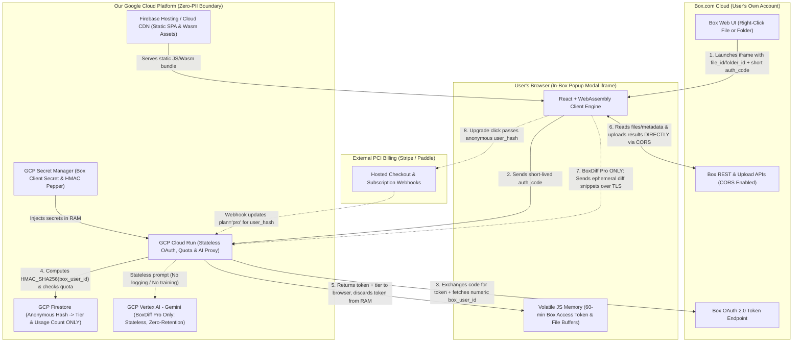

# Zero-PII GCP Architecture & Product Blueprint: `BoxDiff` & `SafeShare`

Combining **#2 (SafeShare Scrub)** and **#3 (ShareRadar)** into one unified privacy product while keeping **#1 (BoxDiff)** as its own standalone product is a genuinely smart strategic split:

* **Why #2 + #3 belong together (`SafeShare`):** Together they own one crystal-clear promise—**"Share safely on Box: clean what's hidden *inside* your files before sharing, and audit who still has links *outside* to your folders."** Better yet, combining them fixes *ShareRadar*'s one-time cleanup churn because users return weekly for file scrubbing & redaction. Even cleaner: Box's Developer Console natively lets **one** Box App register **both** a *File Integration* (opens the Scrub & Redact view) and a *Folder Integration* (opens the ShareRadar Folder Audit view)!
* **Why #1 stands alone (`BoxDiff`):** Version and document comparison is a universal daily productivity habit across contracts, PDFs, Word docs, spreadsheets, and designs, and gives us a natural place to leverage **GCP Vertex AI (Gemini)** as a high-margin stateless Pro feature.
* **80% Shared GCP Foundation:** Both apps share the exact same **Zero-PII GCP control-plane pattern** (Cloud Run + Firestore hashed counters + Secret Manager + Stripe webhooks), cutting our backend engineering in half.

---

## 1. System-Wide Zero-PII GCP Architecture Diagram

The golden rule of our architecture: **User files, filenames, emails, names, shared links, and long-lived Box tokens never persist on GCP.** The heavy file/folder work flows directly between **Box's CORS API** and **the user's own browser memory (`<iframe>`)**.



> [!IMPORTANT]
> **What Lives Inside GCP Firestore (The Entire Database Schema):**
> Our Firestore database has literally **one collection** (`entitlements/{user_hash}`):
> * `user_hash`: `"8c4f19a2..."` *(irreversible `HMAC-SHA256(pepper, numeric_box_user_id)` — we cannot reverse this into an identity even if we wanted to)*
> * `plan`: `"free"` | `"pro"`
> * `period`: `"2026-11"`
> * `usage_count`: `4`
> * `stripe_sub_id`: `"sub_1Qxyz..."` *(opaque subscription ID for renewal/cancel webhooks; Stripe holds the billing email/card)*
>
> **Zero emails. Zero names. Zero OAuth refresh tokens. Zero filenames. Zero file contents.**

---

## 2. Deep Dive: App 1 — `BoxDiff` (Visual Version & File Comparison)

### What Each Layer of the Tech Stack Does in `BoxDiff`

| Layer | Technology | Exact Responsibility in `BoxDiff` |
| :--- | :--- | :--- |
| **Box Trigger** | Box File Web App Integration | Appears under `More Actions (...) → Integrations → Compare with BoxDiff` on `.pdf`, `.docx`, `.csv`, `.xlsx`, `.txt`, `.md`, `.json`, `.png`, `.jpg`. Opens the modal inside Box passing `file_id` + `auth_code`. |
| **Browser Client (Core Engine)** | React + TypeScript + Web Workers + Wasm (`pdf.js`, `mammoth.js`, `SheetJS`, `diff-match-patch`, `pixelmatch`, `pdf-lib`) | **1.** Fetches the file's Box Version History (`v1..vN`) or sibling files in the same folder via `api.box.com` CORS.<br>**2.** Downloads the two versions directly into browser RAM.<br>**3.** Runs **Text Redline Diff**, **Visual Curtain / Pixel Diff** (catches layout shifts, scanned invoice changes, altered signatures), or **Spreadsheet Cell Diff** locally.<br>**4.** Compiles a downloadable/saveable `Redline_Report.pdf` using `pdf-lib` and uploads it straight back to the user's Box folder via `upload.box.com`. |
| **GCP Cloud Run** | Stateless Node/Go/Python container (scales to zero) | Exchanges Box `auth_code`, verifies/increments monthly diff count against `Firestore` (`user_hash`), and proxies Pro users' ephemeral diff text snippets to `Vertex AI`. |
| **GCP Vertex AI** | Gemini Flash (same GCP region, zero-retention config) | **Pro Feature ("✨ Executive Change Brief"):** Receives *only* the extracted changed text hunks (e.g., `- Net 30` / `+ Net 60`, typically <20 KB of text—never the full raw document binary), summarizes changes by **Financials, Dates, Clauses & Risks**, streams bullets back to the modal, and retains nothing. |

### `BoxDiff` Request Lifecycle

```mermaid
sequenceDiagram
    actor User as Everyday Box User
    participant Box as Box Web & CORS API
    participant Modal as BoxDiff Browser Modal (Wasm)
    participant Run as GCP Cloud Run (Stateless)
    participant DB as GCP Firestore (Hashed IDs)
    participant Gemini as GCP Vertex AI (Gemini)

    User->>Box: Right-clicks Contract.pdf -> "Compare with BoxDiff"
    Box->>Modal: Opens modal iframe (file_id + auth_code)
    Modal->>Run: POST /oauth/exchange (auth_code)
    Run->>Box: Exchanges code & reads numeric user.id ONLY
    Run->>DB: Lookup HMAC_SHA256(user.id) -> {plan: "pro"}
    Run-->>Modal: Returns ephemeral access_token + plan="pro" (discards from server RAM)
    Modal->>Box: GET /files/{id}/versions & streams v4 + v3 bytes via CORS
    Modal->>Modal: Computes Text Redline + Visual Pixel Diff 100% in browser
    opt User clicks "Summarize Critical Changes" (Pro)
        Modal->>Run: Sends ONLY changed text diff hunks (TLS, in-memory)
        Run->>Gemini: Stateless summary call (Zero Data Retention)
        Gemini-->>Modal: Streams 5-bullet Executive Change Brief
    end
    opt User clicks "Save Redline PDF to Box"
        Modal->>Modal: Builds Redline_v3_vs_v4.pdf via pdf-lib
        Modal->>Box: POST upload.box.com (saves straight into user's Box folder)
    end
```

### `BoxDiff` Freemium Model
* **Free Tier:** 5 comparisons/month, Text & Spreadsheet Redline view.
* **Pro Tier (\$6/mo or \$49/yr):** Unlimited comparisons + **Visual Curtain & Pixel Overlay Diff** (for scans, slides, designs) + **✨ Gemini Executive Change Brief** + **1-Click Save Redline PDF back to Box**.

---

## 3. Deep Dive: App 2 — `SafeShare` (Scrub + Redact + ShareRadar Combined)

### How Two Entry Points Unify Cleanly Inside One App
In the Box Developer Console, we attach **two Web App Integration configurations** to the single `SafeShare` app:
1. **Right-click any File (`Scrub & Redact` tab active):** Inspects hidden metadata, strips EXIF/GPS/Author properties, burns irreversible byte-level redactions, and saves a clean `_SafeCopy` back to Box ready to share.
2. **Right-click any Folder (`ShareRadar Audit` tab active):** Scans the folder tree's sharing metadata to find every forgotten *"Anyone with the link"* URL and external guest, allowing 1-click bulk revocation or expiration stamping.

*(Even purer privacy story: **SafeShare doesn't even need Vertex AI!** 100% of file scrubbing, PII regex/OCR detection, and folder link auditing runs inside the user's browser—meaning **zero bytes of user content or metadata ever touch Cloud Run**!)*

### What Each Layer of the Tech Stack Does in `SafeShare`

| Layer | Technology | Exact Responsibility in `SafeShare` |
| :--- | :--- | :--- |
| **Box Triggers** | **1.** File Integration (`.pdf`, `.jpg`, `.png`, `.heic`, `.webp`, `.docx`)<br>**2.** Folder Integration (all Box folders) | Routes File right-clicks straight to **Tab 1 (Scrub & Redact)** with `file_id`, and Folder right-clicks straight to **Tab 2 (ShareRadar Audit)** with `folder_id`. |
| **Browser Engine — Tab 1 (`Scrub & Redact`)** | TypeScript/React + `exifr` + HEIC Wasm + `pdf.js` (Apache-2.0) + `pdf-lib` (MIT) + `JSZip` + Local PII Regex/Checksums & `Tesseract.js` Wasm OCR | **1. Privacy X-Ray:** Reads hidden EXIF GPS coordinates, embedded EXIF thumbnails, camera serials, PDF/DOCX author names, and hidden comments in <300ms.<br>**2. Auto-PII Finder + Filename PII Check:** Highlights SSNs, credit cards (Luhn), routing/IBANs, phones, and emails in the document *and* warns if PII exists inside the filename itself.<br>**3. True Byte-Destructive Redaction:** Rasterizes redacted pages at 250–300 DPI onto clean bitmaps inside a fresh `pdf-lib` container (no AGPL libraries, zero underlying selectable text).<br>**4. `_SafeCopy` Default + Collision Safety:** Defaults to saving a brand-new `Filename_SafeCopy` file (editable inline, auto-handling `409` name collisions) so `v1` has zero unredacted Box Version History. |
| **Browser Engine — Tab 2 (`ShareRadar Audit`)** | Web Worker recursive Box REST fetcher (`fields=shared_link,has_collaborations,permissions,created_at,content_modified_at,size`) | **1. Zero-Download Tree Scan & Link Stats:** Traverses subfolders pulling `preview_count` (opens), `download_count` (downloads), link access/expiry settings, and external guest tenure.<br>**2. Zero-GCP Delta Tracking:** Compares live counts against an optional `.safeshare_snapshot.json` saved in **the user's own Box** to flag `+Δ new opens/downloads` and `days tracked open`.<br>**3. Bulk Fix:** Executes batched `PUT /files/{id}` (revoke link, add 30-day expiry, force view-only) or `DELETE /collaborations/{id}` straight from browser to Box. |
| **GCP Cloud Run + Firestore** | **Python 3.12 (`FastAPI`)** stateless container + Hashed Firestore counter | **Strictly OAuth code exchange + anonymous `user_hash` Pro entitlement check.** Zero file bytes, zero filenames, and zero shared-link stats ever touch GCP. |

### Complete `ShareRadar` Link & Access Telemetry Specification

Below is every sharing metric we pull, how we compute trends without storing data on GCP, and where Box sets hard platform limits:

#### A. Native Live Metrics (Available Instantly to Every Non-Admin User via Box REST API)
1. **Total Link Opens / Views (`shared_link.preview_count`):** Exact lifetime count of times the Shared Link was opened/previewed in a browser.
2. **Total Link Downloads (`shared_link.download_count`):** Exact lifetime count of times visitors downloaded the file (or zipped folder) through the Shared Link.
3. **Exfiltration Risk & Capabilities (`permissions.can_download`, `can_edit`, `download_url`):** Flags links that allow full raw downloads or edits versus view-only links.
4. **Effective Exposure Scope (`access` & `effective_access`):** Distinguishes `open` (*Anyone on the internet with the link*) from `company` or `collaborators`, including whether an org policy overrode the setting.
5. **Security & Expiration Controls (`is_password_enabled`, `unshared_at`, `vanity_url`):** Shows password status, exact days remaining until auto-expiration (or **`♾️ Never Expires`**), and whether an easily guessable custom vanity URL is active.
6. **File Dormancy vs. Traffic (`created_at`, `content_modified_at`):** Cross-references file age against traffic (e.g., *"File untouched for 18 months, yet public link has 47 opens & 12 downloads"*).
7. **External Guest Tenure (`collaboration.created_at`, `acknowledged_at`, `expires_at`, `role`, `status`):** Exact number of days an outside email address has held access (e.g., **`External Editor for 412 days • No Expiration`**) plus forgotten `pending` invites.

#### B. Derived Trend & Duration Metrics (Stored in User's Own Box — Zero GCP Storage)
Because Box's `shared_link` payload does **not** include a native `link_created_at` field or weekly traffic breakdown for non-admins, `ShareRadar` optionally writes a tiny summary file (`_safeshare_radar_snapshot.json`) **into the user's own Box account**:
8. **Recent Traffic Spikes (`+Δ Opens` & `+Δ Downloads` Since Last Scan):** Diffs today's `preview_count` and `download_count` against the user's prior Box snapshot to trigger high-priority alerts (*"🔥 +11 new opens and +4 new downloads since Oct 15"*).
9. **Tracked Open Duration (`first_seen_open_at` → Days Open):** Tracks exact days each public link has remained continuously open since first audited (paired with file `modified_at` age on first run).

#### C. Hard Box Platform Limits (What Box Does *Not* Expose to Non-Admin Apps)
* **Viewer Reading Dwell Time (*"Kept open for 2m 40s"* or *"Seconds spent on Page 3"*):** Box **does not track session duration/dwell time** on native `app.box.com/s/...` previews—only discrete `+1` open and `+1` download counters. *(Capturing reading seconds requires replacing Box links with a DocSend-style external proxy viewer hosted on our servers, which we intentionally avoid so we never hold persistent user OAuth tokens or visitor IP/PII logs on GCP.)*
* **Individual Anonymous Visitor Timestamps / Who Clicked (`admin_logs`):** Granular per-event preview/download audit timestamps live inside `GET /events?stream_type=admin_logs`, which Box strictly restricts to Enterprise Admin accounts.

### `SafeShare` Freemium Model
* **Free Tier:** Unlimited **"Privacy X-Ray"** metadata inspections + Unlimited **ShareRadar preview scans** (including live **Opens & Downloads counts** on exposed links!) + 3 scrubbed/redacted `_SafeCopy` saves & 5 single-link fixes per month.
* **Pro Tier (\$7/mo or \$59/yr):** Unlimited metadata scrubbing & PDF/image redactions + **Auto-PII & Filename-PII Detection** + **ShareRadar `+Δ` Traffic Spike Tracking & Sort-by-Most-Downloaded** + **1-Click ShareRadar Bulk Remediation** (revoke, force view-only, or stamp 30-day expirations across dozens of links at once).

---

## 4. Which Order Should We Build Them In?

> [!TIP]
> **Recommended Build Sequence:**
> Because **both** apps share the exact same **GCP Cloud Run + Firestore Zero-PII Auth/Billing Template** (roughly ~300 lines of clean backend code total!):
> * **Option A — Ship `BoxDiff` First:** Slightly narrower UI surface (1 file context menu trigger, 1 screen) and showcases GCP + Vertex AI Gemini immediately.
> * **Option B — Ship `SafeShare` First:** The "Privacy X-Ray" (showing hidden GPS coordinates in a photo) + "ShareRadar" (*"You have 14 open public links right now"*) has an outrageous free-to-paid conversion hook, and requires **zero** LLM calls on the backend.
