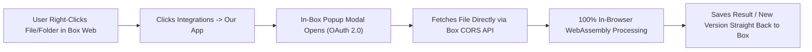

# Box.com Marketplace Deep Research & Everyday App Opportunities

## 1. Executive Summary: The "Barbell Gap" in the Box App Center

The **Box App Center** (Box Integrations) currently lists **1,500+ integrations**, yet its catalog suffers from a massive structural blind spot compared to the Google Workspace Marketplace or Atlassian Marketplace:

* **Heavyweight Enterprise Top-End:** 95%+ of visible listings are enterprise SaaS connectors (Salesforce, Okta, ServiceNow, Splunk, Workato, Microsoft 365, Slack, DocuSign, Adobe Acrobat Enterprise) and high-end enterprise AI/MCP agents. Meanwhile, Box's newest native innovations (*Box AI Studio*, *Box Extract*, *Box Hubs*, *Box Forms*) are heavily gated behind upper-tier **Enterprise Plus** and **Enterprise Advanced** plans.
* **Missing Everyday Bottom-End:** Millions of everyday users—university students and faculty, freelancers, agencies, accountants, medical/legal staff, external clients, and corporate employees on locked-down laptops or web-only devices—live inside the **Box Web UI** every day. When they need to do simple, everyday file tasks, **there are almost zero lightweight micro-utilities in the Box App Center**.

Across Reddit (`r/sysadmin`, `r/cloudstorage`, `r/editors`) and **Box Pulse / Box Community** (`pulse.box.com`, `community.box.com`), the #1 everyday complaint is the **"Download → Fix Locally → Re-Upload Tax"**: users are forced to download files from Box to their local hard drive just to perform basic operations, then manually re-upload them.

> [!IMPORTANT]
> **Traps We Audited & Avoided (Waves 1 & 2):** Before shortlisting ideas, we checked what **already exists** natively in Box or in the Box App Center so we don't build into a wall:
> * **Generic File Conversion:** *CloudConvert* is already listed in the Box App Center.
> * **Basic PDF Fill & Sign:** *DocHub*, *Adobe Acrobat*, and native *Box Sign* already cover basic e-signatures and form filling.
> * **Markdown Editing:** Box already built a **native in-browser Markdown (`.md`) editor** (with split code/preview modes) straight into Box Preview.
> * **Whiteboarding / Diagramming:** **Box Canvas** is now bundled natively across **all** Box plans (including Free Individual).
> * **Basic `.HEIC` Web Viewing & Email Saving:** Box Preview already dynamically renders iPhone `.heic` photos in browsers, and official *Box for Gmail / Outlook* add-ons already handle saving email attachments.

---

## 2. Our Unfair Technical & Trust Advantage on Box

Building a **Box Web App Integration** as a two-person/indie project has three major structural advantages:

1. **\$0 Marketplace Gatekeeping & Native Right-Click Discovery:** Creating a Box Developer account and publishing an OAuth 2.0 **Web App Integration** to the Box App Center has **\$0 listing fees**. Once installed, your tool appears directly inside the Box Web UI context menu (`More Actions (...) → Integrations → [Your App]`) on matching files or folders, launching inside an **in-page modal (`<iframe>`)** so the user never leaves Box.
2. **100% Client-Side Processing via Box CORS (`api.box.com` & `upload.box.com`):** Box explicitly supports whitelisted browser **CORS** requests for reading file bytes, reading folder metadata, and uploading new files/versions.
3. **Solves the #1 Box Adoption Barrier (Security & Admin Trust):** Box organizations and privacy-conscious users hate sending confidential documents to unknown third-party servers. By processing files **100% client-side in browser memory (via WebAssembly/JS)** inside the Box popup modal, we can truthfully guarantee:
   * **Zero External File Storage:** User files flow directly between Box and the user's browser memory—never touching or sitting on our servers.
   * **Near-\$0 Infrastructure Cost:** No expensive server compute or bandwidth bills for processing multi-hundred-megabyte files, enabling a generous free tier with ~95% gross margins on Pro upgrades.

---

## 3. Batch 1: Core In-Browser File & Folder Utilities (Ideas 1–5)

### Idea 1 (Top Pick 🏆): **BoxDiff** — Instant Visual Version & File Comparison

* **The Everyday Pain:** Box automatically tracks `v1`, `v2`, `v3`... up to 100+ versions of every file in Version History—**yet Box has zero built-in visual diff or redline comparison tool in the browser**, and there is **no lightweight comparison app in the Box App Center**. Today, when someone uploads a revised contract, resume, invoice, slide deck, or CSV, everyday users literally open `v1` and `v2` in two separate browser tabs and squint back-and-forth, or download both files locally.
* **How It Works:**
  * Right-click any `.pdf`, `.docx`, `.csv`, `.xlsx`, `.txt`, `.json`, or image in Box → `Integrations → Compare Versions / Diff`.
  * The in-Box modal automatically loads the current file (`v4`) and lets you pick any prior version (`v3`, `v2`, `v1`) from a dropdown **or** pick a second file in the folder (e.g., `Proposal_Draft.pdf` vs `Proposal_Client_Edits.pdf`).
  * **3 Smart Diff Modes:**
    1. **Document Text Redline (PDF / DOCX / Text):** Clean green insertions and red deletions with a "Jump to Next Change" sidebar (plus an optional 3-bullet summary of changes).
    2. **Visual Curtain / Pixel Overlay (PDF Layouts, Scans, Slides, Images):** A draggable before/after slider and blink-toggle that immediately reveals changed numbers on a scanned invoice, shifted layout elements, or altered signatures.
    3. **Spreadsheet Diff (CSV / XLSX):** Highlights added rows, removed rows, and exact changed cell values.
  * One click on **"Save Redline Report PDF to Box"** drops a clean visual comparison report back into the folder.
* **Why It's Worth Considering:**
  * **Universal Daily Habit:** Students, lawyers, accountants, PMs, designers, HR, and engineers all ask *"What actually changed in this new version?"* multiple times a week.
  * **Built-In Viral Loop:** Saving `Comparison_v2_vs_v3.pdf` into a shared Box folder exposes every collaborator in that folder to the tool organically.
  * **100% Browser-Native MVP:** Mature client-side engines (`pdf.js`, `mammoth.js`, `SheetJS`, `diff-match-patch`, `pixelmatch`) make an ultra-fast, zero-server-retention MVP completely achievable.

---

### Idea 2: **UnpackBox (or ZipCraft)** — 1-Click Cloud Unzip, Selective Extract & Encrypted ZIPs

* **The Everyday Pain:** One of the longest-running frustrations on `community.box.com`: **Box cannot unzip/extract a `.zip` file in the web browser.** Box Preview lets you *peek* at the filenames inside a `.zip`, but to actually extract the files into a Box folder, you must download the entire archive (even if it's 1 GB!), unzip locally on a desktop OS, and re-upload everything back to Box—burning double bandwidth, failing completely on iPads/Chromebooks/phones, and triggering Box's hidden Fair-Use bandwidth throttles. On Google Drive, *ZIP Extractor* is one of the most installed apps of all time—yet **ZIP Extractor does not exist on the Box App Center**.
* **How It Works:**
  * **On any `.zip` / `.tar.gz` / `.7z` file:** Right-click → `Integrations → Unzip Here`. Opens an instant file tree inside Box where the user can click **"Extract All to Folder"** in 1 click, **or** check just 2 specific files inside a huge 400-file archive and extract *only* those straight into Box.
  * **On any Box Folder:** Right-click → `Integrations → Create Password-Protected .ZIP`. Bundles client deliverables into an AES-encrypted `.zip` archive saved right inside Box (solving another gap when users need an encrypted bundle before sending an external link).
* **Why It's Worth Considering:**
  * **Zero Explanation Required ("Pure Painkiller"):** High-intent keyword discovery—anyone frustrated by a `.zip` in Box searches the App Center for `"zip"` or `"unzip"`.
  * **Proven Marketplace Model:** Brings a battle-tested multi-million-user Google Drive utility archetype to an underserved ecosystem.

---

### Idea 3: **SafeShare Scrub** — 1-Click Personal Redactor & Hidden Metadata / EXIF Cleaner

* **The Everyday Pain:** Everyday users constantly generate Box Shared Links for sensitive personal or client documents: photos of IDs/passports, tax forms, medical receipts, signed leases, bank statements, or client screenshots. Two dangerous leaks happen because **Box has zero native redaction or metadata scrubbing**:
  1. Smartphone photos and scans retain **hidden EXIF metadata** (exact home GPS coordinates, timestamp, camera serial), while PDFs and Word docs retain **hidden author names, revision trails, and comments**.
  2. Users frequently fail at DIY redaction (e.g., drawing a black shape over text in a PDF previewer without realizing the underlying SSN or bank account text can still be highlighted and copied!).
  * Existing redaction vendors on Box (*TeraDact*, *ImageTrust*) are heavyweight enterprise compliance appliances—leaving everyday users, freelancers, clinics, realtors, and small teams completely unserved.
* **How It Works:**
  * Right-click any `.pdf`, `.jpg`/`.png`/`.heic`, or `.docx` → `Integrations → Clean & Redact Copy`.
  * **Instant Privacy X-Ray Card:** Immediately flags hidden metadata found in the file (*"Alert: Exact GPS Coordinates, Author Identity, and 3 Hidden Properties found"*) with a 1-click **"Scrub All Metadata"** switch.
  * **True Byte-Level Redaction:** Auto-detects emails, phone numbers, SSNs, credit cards, and account numbers via client-side OCR/regex so users can check-to-redact or drag a box over faces/signatures—permanently burning/flattening the redaction so underlying text is destroyed forever.
  * Saves `Document_Redacted.pdf` back to Box (never overwriting their original unless asked) and offers a 1-click Box Shared Link button.
* **Why It's Worth Considering:**
  * **Visceral "Aha!" Moment:** Showing a user a map pin of the hidden GPS coordinates embedded inside a photo they were about to share publicly creates instant trust and word-of-mouth.
  * **Unbeatable Client-Side Pitch:** Unredacted PII is scrubbed inside the user's browser before leaving their machine.

---

### Idea 4: **TidyBox** — Batch Renamer, Folder Blueprints & Zero-Download Duplicate Cleaner

* **The Everyday Pain:** Verified marketplace gap: **there are zero apps in the Box App Center for bulk renaming, folder templates, or duplicate file detection** (whereas *Filerev* has massive adoption on Google Drive). In Box Web today:
  * You have to rename `IMG_3910.jpg`, `IMG_3911.jpg`, `Scan_001.pdf` **one file at a time**.
  * Every time a freelancer, professor, accountant, or project lead starts a new client/project, they manually recreate the same 10 subfolders over and over.
  * Duplicate copies clutter shared folders and eat up Box Individual (10 GB) and Business Starter (100 GB) storage quotas.
* **How It Works (Folder Integration):**
  * Right-click any Box folder → `Integrations → TidyBox Organizer`:
    1. **Bulk Rename Studio:** Live before/after preview table for 100+ files at once (Find & Replace, Prefix/Suffix, `YYYY-MM-DD` date stamps, sequential numbering `001–100`, filename cleanup) + **1-Click Undo History**.
    2. **Instant Zero-Download Duplicate Finder:** Uses a hidden superpower of Box's REST API—Box natively returns every file's `sha1` cryptographic hash in folder item listings! TidyBox can scan thousands of files across subfolders and pinpoint **100% exact byte-for-byte duplicates in seconds without downloading a single byte of file content**.
    3. **1-Click Folder Blueprints:** Save any folder hierarchy (plus starter files) as a reusable template and stamp it out with placeholders like `{{Client_Name}}` or `{{Project_Code}}`.
* **Why It's Worth Considering:**
  * **Magical Speed via Box `sha1` Metadata:** Finding duplicates across 20 GB of Box folders in 3 seconds with zero file downloads feels like magic to users and costs us zero bandwidth.
  * **High Retention:** Folder Blueprints and Batch Renaming become a weekly habit rather than a one-time cleanup.

---

### Idea 5: **GridSafe for Box** — Corruption-Free CSV, TSV & JSON Table Editor

* **The Everyday Pain:** While Box added a native Markdown editor, **`.csv` and `.json` files remain strictly read-only in Box Web**. When everyday business, finance, research, or ops users open a `.csv` through Excel or Google Sheets integrations just to edit three cells or filter rows, spreadsheet apps notoriously **corrupt raw data**—silently stripping leading zeros from ZIP codes (`02138` → `2138`) and IDs, mangling ISO dates, breaking UTF-8 characters, converting long numbers into `1.23E+15`, and saving as `.xlsx` instead of updating the `.csv` version!
* **How It Works:**
  * Right-click any `.csv`, `.tsv`, `.json`, or `.jsonl` → `Integrations → Edit in GridSafe`.
  * Opens an instant, Airtable-fast tabular editor (with a collapsible Tree/Table toggle for `.json`) inside the Box popup modal.
  * Strictly preserves exact string formatting (leading zeros, UTF-8, timestamps), supports instant filtering, SQL/search queries, row deduplication, and column validation, and saves directly back as a **new Box Version** of the exact same `.csv` or `.json` file (respecting Box file locks).
* **Why It's Worth Considering:**
  * **Sharp, Undisputed Wedge:** Solves a daily data-corruption headache for analysts, marketers, researchers, and developers working in Box folders, with a super clean, focused scope for a fast v1 launch.

---

## 4. Batch 2: Sharing Hygiene, Tier-Unlocked Workflows & External Handoffs (Ideas 6–11)

Wave 2 research dug into **Box pricing-tier paywalls**, **non-admin blind spots**, and **community complaints around external collaboration** (`Box File Request`, `Shared Links`, media recordings, and physical-to-digital QR workflows)—uncovering 6 completely distinct opportunities:

### Idea 6 (Wave 2 Standout 🌟): **ShareRadar** — Personal "Who Can Still See My Files?" Shared-Link & External-Access Auditor

* **The Everyday Pain:** Regular non-admin Box users have **zero centralized screen in Box to list all active Shared Links or external collaborators across their folders**. Global link and external-user reports live exclusively inside the Enterprise Admin Console! After 1–3 years of daily work, everyday users (professors, consultants, HR leads, lawyers, freelancers, small business owners, and regular corporate employees) have dozens of forgotten *"Anyone with the link"* URLs and ex-contractors/former clients still sitting with Editor access inside nested subfolders—and the only native way to check is opening folders **one by one**.
* **How It Works:**
  * Right-click your top-level project folder (or launch from `Integrations → Audit My Shared Links & Guests`).
  * Pure Box metadata API calls (`shared_link` and `collaborations` JSON—**zero file bytes downloaded!**) scan hundreds of subfolders in seconds and display a Red / Amber / Green **Personal Privacy & Link Hygiene Dashboard**:
    * **Red Alerts:** Public *"Anyone with the link"* items with download enabled and no password or expiration date.
    * **Amber Alerts:** External email addresses (outside your domain) still holding Editor/Viewer access on old folders.
  * **1-Click Bulk Cleanup:** Select 30 forgotten links at once to **Revoke**, **Add a 30-Day Expiration**, **Switch to View-Only**, or **Remove Stale External Guests**—plus export a clean personal audit `.csv`.
* **Why It's Worth Considering:**
  * **Instant Curiosity & Fear-of-Leak Hook:** Almost *nobody* knows what they accidentally left publicly shared in Box two years ago. Running the first free scan guarantees an immediate "Whoa, I had no idea that was still public!" reaction.
  * **Zero File Content Access Required:** Operates strictly on Box folder/link metadata endpoints—blazingly fast, near-\$0 server cost, and effortless to justify to security-conscious users.

---

### Idea 7: **TidyCollect** — Structured Client File Intake + QR Upload Portals (Fixing Box File Request's "Flat Dumping Ground")

* **The Everyday Pain:** On `community.box.com`, native **Box File Request** triggers four constant complaints from everyday users collecting files from clients, students, vendors, or event guests:
  1. **The "Flat Dumping Ground":** If 50 people upload files through a Box File Request link, every file lands in **one flat messy folder** (`IMG_0412.JPG`, `W9.pdf`, `W9 (1).pdf`, `resume.pdf`) with no automatic subfolder per submitter.
  2. **No Simple Auto-Renaming:** Native forms lack a simple naming-rule builder, and workarounds using Box Relay notoriously fail whenever a submitter leaves an optional field blank.
  3. **No Folder Uploads & 1-Form-Per-Folder Limit:** External submitters cannot drag-and-drop a nested folder, and Box restricts each folder to a single File Request form.
  4. **No Built-In QR Code** for mobile/in-person photo or document collection.
* **How It Works:**
  * Right-click any Box folder → `Integrations → Create Smart Intake Portal (+ QR)`.
  * Configure a clean, mobile-ready intake checklist in 30 seconds (e.g., for an accountant: `[ ] Signed W-9`, `[ ] Photo ID`, `[ ] Prior Tax Return`; or for an event/classroom/job site: drag-and-drop photos & folders via QR code).
  * **Automatic Organization:** Every submission automatically creates a clean subfolder (`2026-11-01 — Jane Smith/`) inside your Box folder, **auto-renames every uploaded file** (`JaneSmith_W9_2026.pdf`), validates file types, and streams the files directly into Box without storing them permanently on third-party servers.
* **Why It's Worth Considering:**
  * **Massive External Viral Loop:** Every 1 Box user who creates an intake link or prints a QR code puts your "Powered by TidyCollect for Box" portal in front of 20 to 500 external clients, vendors, students, or guests.

---

### Idea 8: **PacketPress (or BinderBox)** — 1-Click Folder-to-PDF Binder with Auto Table of Contents, Page Numbers & Watermarks

* **The Everyday Pain:** Two verified marketplace and pricing gaps intersect here:
  1. **Zero apps in the Box App Center** take a folder of mixed everyday files (`.pdf`, `.docx`, `.jpg`/`.heic` receipt photos, `.csv`, `.md`) and compile them into a **single polished PDF Binder with an auto-generated clickable Table of Contents, section cover pages, and continuous page/Bates numbering**.
  2. **Native Box Watermarking is locked behind Enterprise Plus / Box Shield!** Users on Free, Personal Pro, Business Starter, Business, and Business Plus plans have **no built-in way to watermark shared PDFs or images in Box**.
* **How It Works:**
  * Right-click any Box folder → `Integrations → Assemble PDF Packet / Binder`.
  * Drag-and-drop to reorder the folder's files, exclude drafts, and toggle:
    * **Auto-Generated Clickable Table of Contents** (with clickable PDF bookmarks per original file)
    * **Continuous Page / Exhibit Numbering** (`Page 1 of 42` or `Exhibit A — Page 3`)
    * **Custom Diagonal or Footer Watermark** (`CONFIDENTIAL — Prepared for Acme Corp — 2026-11-01`)
  * Compiles in-browser and saves `Client_Submittal_Binder.pdf` right back into the Box folder.
* **Why It's Worth Considering:**
  * **Replaces a \$240/yr Adobe Acrobat Pro License for Everyday Packet Builders:** Solves a weekly chore for anyone assembling **monthly expense reports** (1 spreadsheet + 15 phone photos of receipts → 1 numbered PDF!), board packets, grant applications, real estate disclosures, lease packets, student portfolios, and legal exhibits.

---

### Idea 9: **MergeMint ("Autocrat for Box")** — Bulk Spreadsheet-to-Template PDF & Word Generator

* **The Everyday Pain:** On Google Drive, **Autocrat** (merging rows of a spreadsheet into a document template to generate hundreds of personalized PDFs) is a legendary multi-million-user everyday tool. On Box, native **Box Doc Gen is strictly paywalled inside Enterprise Advanced** (Box's highest-priced flagship tier with a 35-user minimum!), and **no lightweight self-serve mail-merge app exists in the Box App Center**. That leaves **95%+ of Box accounts**—including universities, K–12 educators, thousands of `Box.org` nonprofits, small businesses, HR teams, and Business / Business Plus / Enterprise customers—with zero in-Box batch document generation!
* **How It Works:**
  * Place a `.docx` or fillable `.pdf` template (containing simple tags like `{{Full_Name}}`, `{{Course_Title}}`, `{{Invoice_Total}}`) alongside a `.csv` or `.xlsx` spreadsheet inside any Box folder.
  * Right-click the spreadsheet or template → `Integrations → Bulk Merge to PDFs`.
  * Instant live preview of Row 1, automatic column-to-tag matching, dynamic output naming (`Certificate_{{Full_Name}}.pdf`), and 100% in-browser batch generation straight into a `/Generated_PDFs` subfolder in Box.
* **Why It's Worth Considering:**
  * **Box Created a Giant Pricing Umbrella for Us:** By locking *Box Doc Gen* exclusively to Enterprise Advanced, Box validated the exact workflow while leaving every Individual, SMB, University, Nonprofit, and mid-tier Business team wide open for a frictionless \$6–\$8/mo tool.

---

### Idea 10: **ClipScribe** — In-Box Audio/Video Trimmer, `.MOV` Shrinking & Instant `.SRT` / Markdown Transcripts

* **The Everyday Pain:** Everyday Box users store millions of Zoom recordings (`.mp4`), iPhone Voice Memos (`.m4a`), lecture captures, user-research interviews, and huge 4K iPhone videos (`.mov`) in Box—yet **Box has zero native browser tools to trim dead air, compress oversized video files, or transcribe audio/video**. Worse:
  * Free (250 MB limit) and Business Starter (2 GB limit) users constantly hit upload/sharing ceilings or frustrate external Windows recipients who download raw Apple `.mov` files that won't play cleanly without codecs.
  * Existing transcription integrations (*Sonix*, *HappyScribe*) bounce users out into expensive (\$15–\$30/mo), heavyweight external editing suites.
* **How It Works:**
  * Right-click any `.mp4`, `.mov`, `.m4a`, `.mp3`, or `.wav` in Box → `Integrations → Trim, Shrink or Transcribe`.
  * **Client-Side Quick Trim & `.MOV → .MP4` Shrink (`ffmpeg.wasm`):** Trim the awkward first 4 minutes of a meeting recording, extract `.mp3` audio, or compress a 900 MB iPhone `.mov` into a universally playable 95 MB `.mp4` right in browser memory—zero server compute cost!
  * **1-Click Companion Transcript + Subtitles:** Saves a clean, timestamped `Recording_Transcript.md` (which opens beautifully in Box's native Markdown editor!) + `Recording.srt` closed captions right next to the media file in Box.
* **Why It's Worth Considering:**
  * **Free Compute Wedge + High-Value Pro Upgrade:** Client-side `ffmpeg.wasm` trimming/shrinking costs us \$0 to run as a viral free hook, while metered AI transcription hours provide an effortless, high-converting Pro subscription.

---

### Idea 11: **ExpiryPulse & QR Cards** — Renewal Alerts & Print-Ready Dynamic QR Labels for Living Box Files

* **The Everyday Pain:** Two everyday "last-mile" gaps that surprise almost everyone using Box:
  1. **Zero Native Document Expiration Alerts:** People store `Passport.pdf`, `Office_Lease.pdf`, `Vendor_COI_Insurance.pdf`, `Certifications.pdf`, and `Client_Contracts.pdf` in Box—and even if they add an Expiration Date field, **Box cannot email or alert you 30 or 7 days before a document expires!**
  2. **Zero Native QR Code Generator:** Restaurants storing menus in Box, professors sharing syllabi, labs/warehouses posting safety sheets (`SDS`) and equipment manuals, realtors printing property flyers, and event hosts have **no native way to generate a print-ready QR sticker or flyer** tied to a Box file (where uploading `v2` in Box automatically updates what every printed QR code opens!).
* **How It Works:**
  * Right-click any Box file or folder:
    * **Set Expiry / Renewal Watch:** Auto-detects expiration/renewal dates inside contracts, leases, COIs, and IDs → sends 60/30/7-day email reminders and generates a 1-click `.ics` calendar alert.
    * **Generate Dynamic QR Card / Sticker Sheet:** Outputs high-resolution print-ready PDF/SVG QR cards, equipment labels, or tabletop flyers pointing to that living Box file, complete with scan-count tracking.
* **Why It's Worth Considering:**
  * **Ultra-Low Churn ("Set & Never Cancel"):** Once a small business, clinic, property manager, or lab relies on your tool to watch 40 vendor insurance/contract renewal dates or power 25 printed QR codes on physical equipment and menus, retention lasts for years.

---

## 5. Master 11-Idea Opportunity Matrix

| # | Idea | Core Everyday Job | Box App Center Competition | 100% Client-Side Core? | Freemium Pro Hook (\$5–\$8/mo) | Built-In Viral Loop |
| :- | :--- | :--- | :--- | :--- | :--- | :--- |
| **1** | **BoxDiff** 🏆 | Visual redline & pixel diff across Box Versions or 2 files | **None** | **Yes** (Wasm/JS) | Unlimited diffs + Visual Overlay + Save Redline PDF | **Very High** (Redline PDFs shared in team folders) |
| **2** | **UnpackBox** | 1-click cloud unzip, cherry-pick extract & AES password ZIPs | **Very Low** (No ZIP Extractor) | **Yes** (<500 MB local; worker for multi-GB) | Large multi-GB archives + `.7z`/`.rar` + Encrypted ZIPs | **Medium** (High App Center search volume) |
| **3** | **SafeShare Scrub** | True byte-level PDF/image redaction + EXIF/GPS metadata scrub | **Low** (Only enterprise suites) | **Yes** (Zero PII leaves browser) | Batch scrub + Auto-PII OCR detection | **High** (Shock-value GPS/metadata audit card) |
| **4** | **TidyBox** | Bulk file rename, folder templates & `sha1` instant dupe finder | **None** | **Yes** (Pure Box Metadata & `sha1` API) | Unlimited batch rename + 1-click dupe clean + Blueprints | **High** (Teams share Folder Blueprints) |
| **5** | **GridSafe** | Corruption-free `.csv`, `.tsv` & `.json` spreadsheet/tree editor | **Very Low** (Read-only in Box) | **Yes** (`PapaParse` / `DuckDB-Wasm`) | Large 100 MB+ files + SQL filter + JSON↔CSV | **Medium-High** (Ops & data collaborators) |
| **6** | **ShareRadar** 🌟 | Non-admin "Who can see my files?" Shared Link & Guest auditor | **None** | **Yes** (Pure metadata API; 0 bytes downloaded) | Bulk link revoke/expiry + Scheduled monthly hygiene scan | **High** (Instant security wake-up call) |
| **7** | **TidyCollect** | Client upload checklist portals + QR + auto-subfolder & auto-rename | **Low** (Fixes native File Request) | **Hybrid** (Lightweight OAuth relay stream to Box) | Custom branding + Multi-file checklists + Unlimited portals | **Extreme** (1 user sends portal to 50+ outsiders) |
| **8** | **PacketPress** | Folder-to-PDF Binder with clickable TOC, page numbers & watermarks | **None** | **Yes** (`pdf-lib` + Wasm rendering) | Custom watermarks (unlocks Enterprise Plus gap!) + Unlimited pages | **Very High** (Every packet goes to clients/boards) |
| **9** | **MergeMint** | "Autocrat for Box": CSV/Excel rows → bulk personalized PDFs/DOCX | **None Self-Serve** (Box Doc Gen = Enterprise Adv. only) | **Yes** (`docxtemplater` / `pdf-lib`) | Batches >20 rows + Custom filename rules + PDF output | **High** (Huge Edu, Nonprofit & SMB demand) |
| **10** | **ClipScribe** | Browser video/audio trimmer, `.MOV` shrinker & `.SRT`/`.md` transcripts | **Low** (Only heavy \$25/mo external SaaS) | **Hybrid** (`ffmpeg.wasm` local + Whisper API for Pro) | AI transcription minutes + Batch `.MOV` compression | **Medium-High** (`.md` transcripts shared in folders) |
| **11** | **ExpiryPulse + QR** | Contract/ID renewal alerts + print-ready Dynamic QR cards for Box files | **None** | **Hybrid** (Lightweight reminder cron / QR redirect) | >10 tracked renewal files + Dynamic QR scan analytics | **High** (Physical QR cards seen in real world) |

---

## 6. Builder's Shortlist Guide & Go-To-Market Notes

If you want a quick mental model to narrow these 11 down to our **#1 starting project**:

* **Best Overall "Universal Habit + Zero Backend Cost" Product:** **#1 BoxDiff** or **#8 PacketPress** (every white-collar user, student, and freelancer immediately understands them, both produce shareable PDF artifacts inside Box folders, and both run 100% client-side).
* **Best "Instant Shock-Value Hook" (Fastest 10-Second Wow):** **#6 ShareRadar** (*"You have 19 forgotten public links open right now"*) or **#3 SafeShare Scrub** (*"This photo you're sharing contains your home GPS coordinates"*).
* **Best "External Viral Growth Engine":** **#7 TidyCollect** (every portal/QR code exposes dozens of external clients/guests to your product) or **#9 MergeMint** (rides the exact *Autocrat* wave across universities, nonprofits, and SMBs priced out of Box Enterprise Advanced).
* **Best "Fastest Weekend MVP to Ship & Rank in App Center Search":** **#2 UnpackBox**, **#4 TidyBox**, or **#5 GridSafe**.

> [!TIP]
> **How to Win Distribution & Bypass Enterprise Friction Early:**
> 1. **Target Self-Serve & Open-App-Center Tenants First:** In strict Fortune 500 Box tenants, IT Admins sometimes restrict unapproved third-party apps by default—*unless* enough users click "Request Access" or the app has a clear **Zero-Data-Retention / 100% In-Browser** architecture page. Meanwhile, millions of Box Individual, Business Starter, Business, agency, SMB, nonprofit (`Box.org`), and university accounts allow direct 1-click user installs from the Box App Center.
> 2. **Publish a "Security & Architecture" Badge Day 1:** Having a crystal-clear *"Zero Server Storage: Files are processed locally in your browser via Box CORS and never stored on external servers"* page dramatically accelerates both **Box Partner Review (`integrate@box.com`)** and **IT Admin approvals**.
> 3. **Standalone Web Companion + Box App Center Listing:** Because the core engine runs in the browser, the exact same codebase can *also* run as a public SEO landing page with a **"Connect to Box"** button—giving us two free acquisition channels (Google Search + Box App Center search) from day one!
