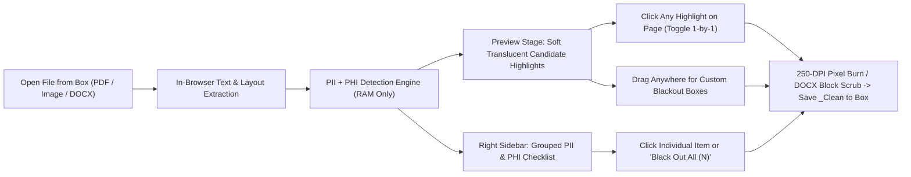

# Feasibility Study: Pre-Identified PII & PHI 1-Click Redaction in SafeShare

> [!IMPORTANT]
> **Executive Verdict: Highly Feasible (100% Browser-Side & Zero-PII Compliant).**  
> SafeShare already contains an early prototype of coordinate-mapped PDF scanning in [`pii_detector.js`](file:///Users/madushan/GitStuff/safeshare-box/static/js/pii_detector.js) and [`redactor_engine.js`](file:///Users/madushan/GitStuff/safeshare-box/static/js/redactor_engine.js#L114-L144). Upgrading it into a comprehensive **PII + HIPAA PHI Pre-Identification & 1-Click Redaction Studio**—where candidates appear automatically on open, can be toggled **one-by-one** (from the list or directly on the page) or **all at once (`Black Out All`)**, while keeping freehand drag-to-redact—requires **zero backend changes** and sends **zero bytes to GCP**.

---

## 1. Current Baseline vs. Target Experience

### What SafeShare v1 Does Today (and Why It Falls Short)
1. **Limited to 5 Regex Patterns on Digital PDFs:** [`detectPiiInTextItems`](file:///Users/madushan/GitStuff/safeshare-box/static/js/pii_detector.js#L95-L136) currently checks only SSN, Credit Card, Email, US Phone, and ABA Routing on selectable PDF text.
2. **Span-Split Blindness in `pdf.js`:** Today each `pdf.js` text fragment (`item.str`) is scanned in isolation. When a PDF splits `"SSN:"` and `"123-"` and `"45-6789"` into separate text runs, matches are missed.
3. **Inverted Default (`enabled: true`) & Missing Bulk Controls:** Matches currently default to solid black immediately (hiding the underlying text before the user verifies it), with no **`Black Out All` / `Clear All`** button and no click-on-canvas toggle.
4. **Zero Detection on Images, Scanned PDFs, or `.docx` Body Text:** Photos (`.jpg`/`.png`), scanned/faxed PDFs without a text layer, and Word documents currently show zero pre-identified text items.
5. **No Healthcare PHI / HIPAA Safe Harbor Identifiers:** Missing Medical Record Numbers (`MRN`), Medicare Beneficiary IDs (`MBI`), National Provider IDs (`NPI`), Dates of Birth (`DOB`), admission/discharge dates, street addresses, and patient/provider names.

---

## 2. Proposed User Experience Flow

### Key UX Mechanics
- **See-Through Candidate Highlights First (Opt-In or 1-Click All):** Detected PII/PHI spans render on the page as soft amber/blue translucent boxes with a subtle border so the user can **read and verify** each candidate in context before covering it.
- **3 Seamless Ways to Redact Together:**
  1. **One-by-One (List or Canvas):** Click an item in the sidebar (auto-scrolls/jumps to its page!) **or** click directly on a highlighted box on the canvas to flip it between *Highlighted Candidate* ↔ *Solid Blackout*.
  2. **All at Once (`Black Out All` / Category Pills):** One primary **`Black Out All (14)`** button covers every detected item across all pages instantly (plus category quick-toggles like `Medical / PHI`, `Contact`, `Financial & IDs`, and `Unselect All`).
  3. **Custom Drag Redactions Always Active:** Dragging on any empty area draws custom blackout boxes (for signatures, faces, stamps, or handwritten notes) right alongside auto-detected boxes.

---

## 3. Technical Feasibility Across 3 Progressive Tiers

Because SafeShare enforces a strict **Zero-PII / 0-bytes-to-GCP** architecture, all detection must run inside browser RAM (`WebAssembly` / `JavaScript` / `Web Workers`) using self-hosted bundles in `/static/vendor/`.

| Dimension | **Tier 1: Line-Stitched Rules + HIPAA PHI** | **Tier 2: + Wasm OCR for Images & Scans** | **Tier 3: + Tiny Browser AI (ONNX NER)** |
| :--- | :--- | :--- | :--- |
| **Target Formats** | Digital PDFs + `.docx` Word files | **+ `.jpg`, `.png`, `.webp` & Scanned PDFs** | All formats (adds free-text entity context) |
| **What It Catches** | **Structured PII & HIPAA PHI (20+ types):** SSN, ITIN, Credit Cards (Luhn), ABA, IBAN, Passport/DL, Email, Phone, Street Address, ZIP+4, **DOB / Clinical Dates, MRN, Medicare MBI, NPI (Luhn), DEA, Member IDs, ICD-10**, labeled `Patient:` / `Name:` | Everything in Tier 1, extracted from **raw image pixels & scanned copier PDFs** via word-level OCR bounding boxes | **Unlabeled free-prose Person Names**, Hospital/Org names, and Locations in unstructured paragraphs (e.g., *"saw **Jane Doe** at **Mercy Clinic**"* without a `Patient:` label) |
| **Tech Stack (Self-Hosted)** | Pure ES Modules (0 external libs) | `Tesseract.js` v5 (`Apache-2.0`) in Web Worker | `@huggingface/transformers` (`Apache-2.0`) + quantized `BERT-NER` / `Piiranha` ONNX |
| **Extra Bundle Size** | **~8 KB** (instant) | **~14 MB** (*lazy-loaded only on images/scans*) | **~28–60 MB** (*lazy-loaded opt-in model*) |
| **Scan Speed** | **< 40 ms** for a 20-page PDF | **~1.2–2.5 sec / page** in background Worker | **~0.6–1.8 sec / page** (Wasm SIMD / WebGPU) |
| **False-Positive Risk** | **Very Low** (checksums + context anchors) | **Low–Medium** (depends on scan DPI/clarity) | **Medium** (may flag benign company/author names — easily unchecked in UI) |
| **Zero-PII Guarantee** | 100% Browser RAM | 100% Browser RAM | 100% Browser RAM |
| **Engineering Effort** | **Small (~0.5 day)** | **Medium (~1 day)** | **Medium–High (~1.5–2 days + CSP tuning)** |

---

## 4. Deep Dive: Solving Each Hard Corner Case

### A. Fixing Split Text Spans on PDFs (Critical for Accuracy)
In [`redactor_engine.js`](file:///Users/madushan/GitStuff/safeshare-box/static/js/redactor_engine.js#L114-L144), `pdf.js` returns fragments sorted by PDF drawing order rather than reading order, often splitting single values across spans.
- **Solution:** Sort page spans by `(roundedY, x)`, join adjacent spans on the same baseline into full reconstructed lines, and store a **character-offset → normalized `[x, y, w, h]` lookup array**. Any regex/PHI match across the full line maps back to exact character-level bounding boxes—even if a phone number or MRN spans 3 PDF text tokens.

### B. Healthcare PHI (HIPAA 18 Safe Harbor) Precision Tricks
Several high-value PHI identifiers have strict mathematical or structural rules that avoid noisy false positives:
- **NPI (National Provider Identifier):** 10 digits passing the official **ISO Luhn checksum with `80840` prefix** — near-zero false positives.
- **Medicare Beneficiary Identifier (`MBI`):** 11 characters following CMS's exact positional alphabet (excludes `S, L, O, I, B, Z` at specific slots).
- **Dates & Ages > 89 (HIPAA Rule):** Detect dates anchored by `DOB`, `Birth`, `Admit`, `Discharge`, `DOS`, plus standalone dates (`MM/DD/YYYY`, `YYYY-MM-DD`, `Jan 15, 1982`) and ages `90+`.
- **MRN / Account / Claim Numbers:** Context-window regexes triggered within 25 characters of clinical labels (`MRN`, `Medical Record`, `Patient ID`, `Chart #`, `Claim #`, `Policy #`, `Member ID`).

### C. Word (`.docx`) Body Redaction Without Breaking Layout
Right now `.docx` only strips hidden XML properties (`core.xml`, `app.xml`, `comments.xml`).
- **Solution:** Parse `word/document.xml` via `JSZip`, extract paragraph text, surface detected PII/PHI in the exact same sidebar checklist, and for every item the user selects, replace the matched characters inside `<w:t>` nodes with `█` (`U+2588` full block) of matching length—preserving Word tables, fonts, headers, and styles while permanently destroying the underlying characters in the saved `_Clean.docx`.

### D. Why Avoid Cloud DLP API for Now?
Google Cloud's **Sensitive Data Protection (Cloud DLP)** API is available in GCP, **but** calling it would transmit document text to Google Cloud Run / DLP endpoints—breaking SafeShare's core **`Private in browser` (0 file bytes leave your device)** promise and requiring HIPAA BAA / privacy policy changes. Keeping detection 100% inside browser Wasm/JS preserves SafeShare's strongest trust differentiator.

---

## 5. Recommended Rollout Strategy

> [!TIP]
> **Recommended Phased Path (Best ROI & Fastest Time-to-Value):**
> 1. **Phase 1 (Immediate High-Impact Win — Zero Bloat):** Build **Tier 1** first:
>    - Line-stitched PDF coordinate mapper + `.docx` `<w:t>` body text redactor.
>    - 20+ PII & HIPAA PHI detectors (SSN, Cards, Routing, IBAN, Email, Phone, Street Address, DOB/Dates, Medicare MBI, Provider NPI, DEA, MRN/Patient ID, labeled Names).
>    - New interactive UI: soft see-through candidate highlights on open, **click-on-page** or **click-in-list** toggle, **`Black Out All (N)`** / **`Clear All`** buttons, category filter pills, plus existing drag-to-redact custom boxes.
> 2. **Phase 2 (Image & Scanned PDF Expansion):** Add lazy-loaded **`Tesseract.js` Wasm Worker (Tier 2)** so `.jpg`/`.png` screenshots, ID photos, and scanned copier PDFs get the exact same pre-identified PII/PHI checklist automatically.
> 3. **Phase 3 (Optional Pro "Deep Name Scan"):** Add opt-in quantized **ONNX Browser NER (Tier 3)** behind a *"Scan for unlabeled names"* button so standard file opens stay instantaneous (`< 50 ms`).
